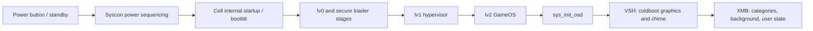

# PS3 boot and game launch: what the PSX tool could honestly show

Thinker: Codex. Survey date: 2026-10-10. Target firmware context: the user's 4.82 PUP. This is a research report and feature
assessment; no product code was written.

## Evidence and boundaries

[I] means public documentation, interpretation, engineering assessment, or a proposal. Every section and table below is [I]
unless an individual finding is explicitly [V]. [V] is reserved for bytes independently read in `bios/PS3UPDAT.PUP`, with
absolute offsets. An offset from a wiki, an emulator source file, or existing repository code does not earn [V]. No plaintext
PS3 disc, save, theme, trophy set, or `dev_flash` was supplied for this survey. Their presence, contents, fidelity, and
compatibility therefore remain unverified here.

[I] I read `repo/notes/research/README.md`, including all three rounds, and `ps3_pup.md`. The relevant continuity is the
existing evidence-first hand-off map, ROM identity work, asset provenance, card/icon viewers, and the distinction between
prediction and execution. I also read the current PUP, ROMDIR, PS1 BIOS, sound, card, and icon readers and manifests. Those
repository observations are treated as [I] under this task's stricter evidence rule.

[I] Public format and architecture pages supplied the PS3 background; URLs are listed last. I used format descriptions and
parser structure, not downloadable firmware or asset samples. Cryptographic-material pages, decryption instructions, and
protected-format key tables were outside the survey. Linked archives, firmware collections, and decryption tools were not used.
The report contains no cryptographic keys, IVs, or decryption parameters.

[I] Plaintext here means readable file bytes, possibly compressed or encoded, without a secret. It does not mean textual,
uncompressed, publicly licensed, or bundled by our application. An installed resource file and an encrypted package that
contains that file are different inputs. Ownership of a console or disc alone does not establish that a PC can read every stored
byte. All proposed readers consume the user's existing readable files and stop at protected content.

## Recommendation first

[I] **Name the PS3 disc hand-off card first.** It offers a visible, useful PS3 feature without requiring system artwork: the
user's title, icon, background, advertised capabilities, firmware requirement, disc update identity, and the point where
executable inspection stops. It extends the PS2 hand-off idea while stating which decisions need console state.

[I] The PUP identity card is the immediate demonstration using the file actually available. It already has a repository reader
and CLI, so present it as existing groundwork to extend. It cannot render the PS3 opening, discover the user's console model, or
supply a PS1 BIOS.

[I] After disc/save metadata, prioritize a bounded resource browser for an existing plaintext `dev_flash`, with image previews
and VAG playback. Defer faithful coldboot playback and the moving XMB wave until their behavior can be derived from supplied
assets and supported formats. An asset gallery, a documented transition diagram, and a faithful animation are distinct claims.

## What the local 4.82 PUP actually verifies

[V] The file size is 206,167,196 bytes. Its eight-byte magic at `0x00000000` is `SCEUF` plus three zero bytes. The big-endian
header contains the following independently checked fields:

| Absolute offset | Field | Value |
|---|---|---|
| `0x08` | Container version | 1 [V] |
| `0x10` | Image/build value | `0x105F2` [V] |
| `0x18` | Entry count | 9 [V] |
| `0x20` | Header length | `0x290` [V] |
| `0x28` | Data length | `0xC49DA0C` [V] |
| `0x30` | First entry: ID / offset / size | `0x100` / `0x290` / 5 [V] |
| `0x290` | First member bytes | `4.82` followed by LF [V] |

[V] Nine 32-byte entries occupy `0x30..0x150`; all entry padding words are zero. The entries are contiguous and end exactly at
the file size. Digest-table index words at `0x150`, then every `0x20` bytes through `0x250`, are 0 through 8. No secret was
requested. [I] Displaying stored digest fields does not authenticate the PUP; arithmetic checks are structural.

[V] Entry `0x201` at table offset `0xB0` locates a 10,240-byte tar at `0x5B3C49`. Its only member is an empty regular file named
`a`; its data begins at `0x5B3E49`. [I] The public name `vsh.tar` is an ID convention, not an embedded PUP filename. Its name
therefore gives no evidence that it contains VSH graphics or an executable.

[V] Entry `0x300` at table offset `0xF0` locates `update_files.tar` at `0x5B644C`, with 194,426,880 bytes. Reading its tar
headers finds **50 regular members**: 48 type-3 SCE packages and two type-2 revocation containers. The latter start at
`0x1A78E4C` and `0x1A7944C`; type is read at member start plus `0x0A`. [I] This agrees with README round three's correction of
`ps3_pup.md`'s older 48-member count.

[V] Entry `0x501`, at `0x110`, locates the secondary-header tar at `0xBF21C4C`. It has 48 regular members, each 640 bytes,
corresponding to the 48 type-3 packages. The two revocation containers have no corresponding member in that tar.

[V] `CORE_OS_PACKAGE.pkg` starts at `0x14C6A4C`; its SCE header declares type 3 and header length `0x280`. The descriptor at
`0x14C6CCC` declares 7,340,000 content bytes at descriptor `+0x18` and 5,895,185 stored bytes at `+0x20`. [I] These are
container declarations, not evidence of a successfully decoded CoreOS.

[V] `dev_flash_000.tar.aa.2017_08_24_192904` starts at `0x1A7A44C`. Its descriptor begins at `0x1A7A6CC`, declaring 40,960
content bytes and 1,309 stored bytes. The protected payload boundary is `0x1A7A74C`, member start plus `0x300`. [V] The last
numbered flash package starts at `0xB9CD84C`; its descriptor is at `0xB9CDACC`. Its declared content size is 5,632,000 bytes,
and its stored size is 5,580,187 bytes.

[V] The outer tar names expose 23 `dev_flash_000..022` packages and one `dev_flash3_023`. Their summed stored sizes are
172,630,229 bytes; descriptor content sizes sum to 195,809,280. [I] The `dev_flash3` package is a separate mount's data; calling
these 24 `dev_flash` files without that distinction would be misleading. Neither mount's inner directory is visible here. No
finding above identifies which numbered package contains a boot image or emulator ROM.

## Boot chain in terms of what reaches the television

[I] The public architecture describes the normal path below. It is an explanatory ordering, not a measured timeline, and loader
organization varies with hardware and firmware. [Boot Order](https://www.psdevwiki.com/ps3/Boot_Order),
[VSH](https://www.psdevwiki.com/ps3/VSH).

[I] Syscon handles power sequencing and reset; Cell startup and bootldr establish hardware and load lv0. The documented loader
families include metldr, lv1ldr, lv2ldr, and appldr. From 3.60, public documentation describes loaders incorporated into lv0; a
launch-era diagram should not be presented as the precise physical layout of the 4.82 firmware. lv1 supplies the hypervisor
environment; lv2 supplies GameOS; `sys_init_osd.self` starts VSH.

[I] The television splash and orchestral coldboot sound belong to **VSH startup**, after lv2 exists. They are not an animation
drawn by syscon, bootldr, or the hypervisor. VSH's `custom_render_plugin.sprx` coordinates the coldboot and transition
resources; `raf.sprx` supports RAF scenes. A hardware power beep is a separate event from the AC3 chime. [Custom render
plugin](https://www.psdevwiki.com/ps3/Custom_render_plugin).

[I] Publicly documented sound variants are `coldboot_stereo.ac3` with two channels and `coldboot_multi.ac3` with six, including
LFE. Selection belongs to the shell's audio setup: stereo versus an enabled, supported multichannel output configuration. The
exact selector predicate in 4.82 is not established by the safe documentation read here. Expose the two streams and an explicit
output-profile assumption, not a claimed recovered choice. [Coldboot.raf](https://www.psdevwiki.com/ps3/Coldboot.raf).

[I] Sony documents connector selection, supported formats, and HDMI automatic negotiation. AV MULTI is stereo; HDMI and optical
can support multichannel configurations. HDMI alone does not imply the six-channel chime: a connected television may expose
stereo. `Audio Multi-Output` means simultaneous connectors, not the `_multi.ac3` filename convention. The PUP contains neither
the user's saved audio settings nor the connected receiver's capabilities. [Audio
settings](https://manuals.playstation.net/document/en/ps3/3_10/settings/audiooutput.html),
[Multi-output](https://manuals.playstation.net/document/en/ps3/current/settings/audiomulti.html).

[I] The XMB wave is a realtime background, not a video file or a loop of PNG frames. Its documented resource path is
`vsh/resource/qgl/lines.qrc`: shaders, settings, textures, and SPU ELF components associated with splines and particles. VSH's
custom-render/QGL stack manages it; `qglbase.sprx` supplies common support. `silk.sprx` is not its renderer. The exact division
of computation among these modules is not fully specified. [QRC](https://www.psdevwiki.com/ps3/Qt_Resource_Container_(QRC)),
[Lines.qrc](https://www.psdevwiki.com/ps3/Lines.qrc).

[I] The documented backgrounds include 24 small monthly DDS textures, with day/night variants. Classic and Original differ;
later Original adds particles. Configuration and runtime state affect presentation. Parsing the archive alone cannot reproduce
CPU/SPU-generated geometry, RSX programs, or every native event. A texture preview is feasible; accurate moving waves are L.
[Theme settings](https://manuals.playstation.net/document/en/ps3/current/settings/themesettings.html).

## System-resource inventory

[I] Paths below are relative to `/dev_flash/`, except the explicitly marked HDD and USB rows. They are documented locations to
recognize in a supplied directory, not PUP discoveries. Version-dependent files must be detected individually; presence does not
establish active use.

| Path | Role and honest observable output |
|---|---|
| `vsh/resource/coldboot.raf` | RAF scene; inspect scene records and supplied texture assets. |
| `vsh/resource/coldboot_stereo.ac3` | Coldboot stereo sound; inspect stream metadata initially. |
| `vsh/resource/coldboot_multi.ac3` | Coldboot surround sound; inspect actual channel configuration. |
| `vsh/resource/custom_render_plugin.rco` | Coldboot/gameboot objects, animation records, native-event references. |
| `vsh/module/custom_render_plugin.sprx` | Protected native transition/background implementation; no execution. |
| `vsh/module/raf.sprx`, `vsh/resource/qgl/raf.qrc` | Native RAF support and associated graphics resources. |
| `vsh/module/qglbase.sprx`, `vsh/resource/qgl/lines.qrc` | QGL support and wave/particle resource container. |
| `vsh/resource/qgl/icons.qrc`, `icontex.qrc`, `rhm.qrc` | Related graphics programs, icon textures, support resources. |
| `vsh/resource/gameboot_stereo.ac3`, `gameboot_multi.ac3` | Historical game-start sounds; not expected in retail 4.82. |
| `vsh/resource/system_plugin.rco` | Navigation/confirmation/error/trophy sounds and shell images. |
| `vsh/resource/xmb_plugin_normal.rco` | Normal XMB presentation resources. |
| `vsh/resource/explore/xmb/*.xml` | XMB category/content configuration; inspect text and references. |
| `vsh/etc/layout_grid_table_*.txt`, `layout_factor_table_*.txt` | Resolution-dependent positions and scale factors. |
| `vsh/resource/theme/01.p3t` | Documented built-in theme location; inventory only if present. |
| `/dev_hdd0/theme/*.p3t`, USB `PS3/THEME/*.P3T` | Installed or portable user-owned themes. |

[I] Source basis: [file paths](https://www.psdevwiki.com/ps3/Files_on_the_PS3), [XMB](https://www.psdevwiki.com/ps3/XMB), and
the format/module pages cited above. [XMB layouts](https://www.psdevwiki.com/ps3/XMB_Layouts) document the external layout
tables. Do not normalize the occasionally inconsistent wiki `module/modules` spelling into two locations. The standard
executable directory used in this report is `/dev_flash/vsh/module/`.

[I] **Historical distinction:** RAF coldboot support appeared in 2.70, not first in 4.xx. Earlier coldboot used the
custom-render RCO path. Contemporary firmware altered timing, branding, and audio naming; the filename alone is not a complete
firmware-era identification. The old SCE wordmark description in `ps3_pup.md` must not become an asserted 4.82 screenshot.
Render the supplied file's imagery, and state when only the RAF scene is being previewed.

[I] **Gameboot distinction:** the old PLAYSTATION 3 launch logo/chime was removed in 3.00. Sony explicitly explains the chime
removal; custom-render documentation describes the resource changes. A residual `anim_gameboot` name is not proof that the old
logo still plays. There is no basis here for promising a standard `gameboot.raf` alongside `coldboot.raf`. [Sony 3.00
Q&A](https://blog.playstation.com/archive/2009/09/08/firmware-3-00-qa), [Custom render
plugin](https://www.psdevwiki.com/ps3/Custom_render_plugin).

[I] System tones are resource entries, not one AC3 soundtrack for all XMB interactions. Documented VAG labels include cursor,
decide, cancel, error, option, and trophy sounds; stereo entries can store separate channel streams. Honor the actual
sound-entry format. Do not infer an always-playing XMB ambient soundtrack from the existence of a background. [RCO
sounds](https://www.psdevwiki.com/ps3/RCOXML_Sounds), [System sound inventory](https://www.psdevwiki.com/ps3/RCOXML_ofw_sounds).

## Format feasibility

[I] The documented coldboot RAF contains nine embedded files: plane geometry and skeleton,
six GTF logo/footer/blur textures covering HD and SD variants, and a compiled VSMX scene script.
The listed logo texture sizes are 700×350 for HD and 240×120 for SD. These are documented examples,
not measurements of our encrypted 4.82 payload. RCO timing and native host events still matter;
replaying only this scene should be labeled a resource preview, not a complete cold boot.
[Coldboot resource inventory](https://www.psdevwiki.com/ps3/Coldboot.raf).

[I] S = a bounded reader or small adapter using existing infrastructure; M = a new format family or significant conversion; L =
an interpreter, codec, graphics behavior, or uncertain fidelity. These are relative implementation sizes, not schedules. Reader
and renderer costs are separate. All costs assume robust bounds checks and user-supplied fixtures, with no firmware embedded.

| Format | Documented structure | Plain at file level? | Reader / useful rendering |
|---|---|---|---|
| RAF | `_RAF` wrapper, zlib-compressed RAFO/CXML scene and file tables. | Yes; compression is not encryption. | M listing/assets; L faithful scene. |
| CXML | Header plus tree, ID, string, integer/float-array and file tables. | Yes. | M reusable container foundation. |
| RCO | PS3 big-endian FRP header, hierarchical resource/object/animation tables, compression. | Yes. | M assets; L full native-linked interface. |
| GIM | Endian/style marker, hierarchical image/palette blocks, dimensions, pitch and pixel format. | Yes. | M conversion to RGBA. |
| GTF | Texture container plus RSX texture layout and format descriptors. | Yes. | S metadata; M supported pixel layouts. |
| DDS | Standard surface header, pixel masks or block-compressed payload, mip levels. | Yes. | S simple RGBA; M broader formats. |
| VAG | Header and Sony ADPCM blocks; channel separation may be in the parent resource. | Yes. | S wrapper/playback using existing decoder. |
| AT3 | Usually RIFF/WAVE carrying ATRAC-family compressed audio. | Yes. | S metadata; L codec implementation. |
| AC3 | Standard syncframes with bitstream information and encoded audio blocks. | Yes. | S metadata; L decoding/conformance. |
| QRC | PS3 QRCC compressed wrapper and QRCF/CXML tables. | Yes. | M listing/texture gallery; L wave. |
| P3T | P3TF/CXML theme description and embedded media, sometimes RAF. | Yes as a readable P3T file. | M static preview; L dynamic behavior. |
| SFO | PSF header, 16-byte index records, name/data tables, typed values. | Yes. | S typed inspector and labels. |
| SFB | `.SFB`, big-endian name/offset/length records and disc descriptors. | Yes. | S disc identification/flags. |
| PNG | Standard chunks, image metadata, compressed image data, checksums. | Yes. | S integration; existing application decoder. |
| TRP | Big-endian archive header, fixed entries with names, offsets and sizes. | Yes for PS3 trophy archives. | S listing; M combined trophy gallery. |
| SELF/SPRX | SCE wrapper with public header fields and protected executable sections. | Headers can be plain; code generally protected. | S bounded header view; no code renderer. |
| PARAM.PFD | Protected-file security metadata accompanying saves and trophy data. | Mixed security structure, not a normal media asset. | S presence/size inventory only in first scope. |

[I] RAF/CXML/QRC/P3T basis: [CXML](https://www.psdevwiki.com/ps3/CXML_Containers),
[RAF](https://www.psdevwiki.com/ps3/Rich_Appearance_Format_(RAF)),
[QRC](https://www.psdevwiki.com/ps3/Qt_Resource_Container_(QRC)),
[P3T](https://www.psdevwiki.com/ps3/PlayStation_3_Theme_(P3T)). The PS3 QRC name is not a guarantee of compatibility with a
modern Qt `.rcc` reader. Use documented PS3 magic/version/table layouts rather than an unrelated desktop archive parser.

[I] RAF's description language covers actors, models, materials, camera, lighting, and script. Compiled contents include
converted geometry, skeleton/animation representations, GTF textures, and VSMX bytecode; extracting them does not recreate the
original authoring files. The public pages leave parts of geometry and native material behavior incompletely specified. A
coldboot-specific asset preview is much smaller than a general dynamic-theme renderer.

[I] VSMX has a documented header, eight-byte instruction records and string/name tables. PS3 version 2 differs from PSP version
1; generic PSP support is not sufficient evidence of fidelity. A new interpreter would need bounded execution, timers, actor
methods and supported native APIs. Reading public reconstructed scripts is not a reason to copy those scripts into our product.
Unsupported instructions or native calls should produce an explicit unsupported scene state.
[VSMX](https://www.psdevwiki.com/ps3/VSMX).

[I] RCO parsing can expose text, image/sound entries, object relationships and animation steps. Animations can reference
`native:/` events implemented by the associated SPRX. The data describes part of the behavior, not a self-contained replacement
for that executable. The documented retail 4.82 RCO family supports zlib; reject unsupported compression variants. Static
previews and an event timeline are credible before a complete interface emulator.
[RCO](https://www.psdevwiki.com/ps3/Resource_Container_(RCO)), [Animation
examples](https://www.psdevwiki.com/ps3/RCOXML_ofw_animations).

[I] GIM needs endian handling, palette/index decoding, alignment, mip/frame traversal, and supported linear or swizzled layouts;
some variants use DXT compression. Coldboot also needs GTF, so a GIM-only implementation will not cover all boot textures. Keep
texture storage format, channel remapping, and display color/alpha interpretation separate.
[GIM](https://www.psdevwiki.com/ps3/Generic_Image_(GIM)), [GTF
documentation](https://www.psdevwiki.com/ps3/Multimedia_Formats_and_Tools#GTF),
[DDS](https://learn.microsoft.com/en-us/windows/win32/direct3ddds/dds-file-layout).

[I] PNG decoding is already enabled through the application's `image` dependency. `ps2kit` itself has no production PNG or
general zlib dependency; its OSD LZ is a different codec. Reusing a decoded RGBA texture is straightforward; reusing
`rom::unpack` for zlib is incorrect. A resource-reader estimate assumes either an explicitly permitted inflate dependency or new
generic inflate work. A strict zero-new-dependencies requirement raises the container-reader cost. [PNG
specification](https://www.w3.org/TR/png-3/).

[I] VAG can reuse `sound::decode_adpcm`'s 16-byte/28-sample Sony ADPCM machinery. New work is the wrapper, sample rate,
per-channel routing, length validation and playback adapter. Existing cpal output and resampling infrastructure can handle the
resulting PCM. PS3 resource tones and PS1/PS2 sequenced VAB music are different containers over related coding. [SPU
coding](https://psx-spx.consoledev.net/soundprocessingunitspu/), [VAG/AT3
formats](https://www.psdevwiki.com/ps3/Multimedia_Formats_and_Tools).

[I] `SND0.AT3` is compressed audio, not a VAG or an uncompressed WAV despite a RIFF wrapper. Identify the actual codec from
container fields; the extension alone cannot select a decoder. Preview duration/rate/channels when supported by readable
metadata, and label unsupported audio. Adding full ATRAC support would be a separate L feature, unnecessary for a title/artwork
preview.

[I] **AC3 recommendation: metadata only initially.** A new Rust decoder is technically possible from ATSC A/52, but is not a
realistic small addition without new dependencies. It needs bit allocation, exponent/mantissa reconstruction, coupling,
transforms, overlap/windowing, channel handling and conformance testing. Existing FFT support does not provide these semantics.
The engineering cost is L even when firmware-specific cryptography is entirely absent.

[I] A header/frame walker can instead show codec ID, sample rate, bitrate, channel mode, LFE, frame sizes, dialnorm and
complete-frame duration. AC3 frames carry 1,536 samples per channel; derive duration from validated frame counts and sample
rate, detecting truncation and format changes. Do not label a header inspection as audio playback, waveform decoding, or
signature verification. [ATSC A/52:2018](https://www.atsc.org/wp-content/uploads/2021/04/A52-2018.pdf).

[I] SFO should follow the executable parser evidence where wiki prose is ambiguous about endian. RPCS3 uses little-endian
numeric header/index fields, with a literal PSF magic byte sequence. Its types distinguish integers, strings and byte arrays;
save `PARAMS` must not be forced to UTF-8. Retain unknown properties and malformed-value diagnostics rather than silently
guessing defaults. [PSF parser](https://raw.githubusercontent.com/RPCS3/rpcs3/master/rpcs3/Loader/PSF.cpp), [PSF
types](https://raw.githubusercontent.com/RPCS3/rpcs3/master/rpcs3/Loader/PSF.h).

## Starting a PS3 game: the hand-off map

[I] A standard disc presents root `PS3_DISC.SFB`, `PS3_GAME/`, and commonly `PS3_UPDATE/`. SFB describes title/content and
hybrid flags; `g` advertises game content and `u` update content. Other flags may advertise themes or video. Inspect declared
flags and actual folder presence together. Wiki examples contain path inconsistencies; standard game metadata is
`PS3_GAME/PARAM.SFO`, while the executable is `PS3_GAME/USRDIR/EBOOT.BIN`. [SFB](https://www.psdevwiki.com/ps3/PS3_DISC.SFB).

[I] The useful order is filesystem/disc recognition → content classification → game tile → selection and policy/version checks →
shell transition → executable loading → game owns display. This is a conceptual map: the precise ordering and overlap of
internal checks is not verified. Some checks occur before selection and some involve mutable HDD content or network services.

| SFO property | What the tool can explain from it |
|---|---|
| `TITLE`, localized `TITLE_*` | Declared visible title, with chosen-language fallback. |
| `TITLE_ID` | Identifier to compare against SFB, saves, and separately supplied installed data. |
| `CATEGORY`, `BOOTABLE` | Content classification and declared bootability. |
| `PS3_SYSTEM_VER` | Declared minimum system-software version. |
| `APP_VER`, `VERSION` | Application/release version fields; preserve their distinct names. |
| `PARENTAL_LEVEL` | Declared rating gate; actual policy also needs console/user settings. |
| `RESOLUTION`, `SOUND_FORMAT` | Advertised mode masks; not proof of a negotiated output mode. |
| `ATTRIBUTE` | Content flags; decode documented bits and retain unknown ones. |

[I] Basis: [SFO property documentation](https://www.psdevwiki.com/ps3/PARAM.SFO) and [RPCS3 capability
masks](https://raw.githubusercontent.com/RPCS3/rpcs3/master/rpcs3/Loader/PSF.h). Compare version strings as structured numeric
fields, never lexically or as floating-point numbers. For example, compare `03.4100` with a supplied 4.82 profile after
normalizing the notation. The 4.82 PUP establishes the update file's version, not the console's installed version.

[I] Before launch, XMB can display `ICON0.PNG`, optional `PIC1.PNG` background and overlay art, optional `ICON1.PAM` moving
icon, and optional `SND0.AT3` tile sound. These are game-provided presentation files, distinct from the system gameboot
transition. Language-suffixed resources can override defaults; content may omit optional presentation files. Start with static
PNG composition; expose PAM/AT3 metadata and unsupported status separately. [Content Information
Files](https://www.psdevwiki.com/ps3/Content_Information_Files).

[I] If system software is below the declared requirement, the console can require an update. Disc-provided update data normally
resides at `PS3_UPDATE/PS3UPDAT.PUP`. Sony documents discs guiding users into the update process. Inspect that already-supplied
PUP using the existing reader; do not install it, download a replacement, or unpack its protected data. Its version can be
compared with the title requirement and the user's declared installed version. [System
Update](https://manuals.playstation.net/document/en/ps3/current/settings/update.html).

[I] Game patches and installed game data can replace relevant disc metadata/executable choices. A disc-only report should say
“base-disc declaration; installed patch state unknown.” Parental settings, auto-start preference, account/licence state where
applicable, disc access, and output negotiation are additional state, not facts recoverable from the disc SFO. Missing state
should yield “unknown,” rather than a green “this console will boot” verdict.

[I] `EBOOT.BIN` is conventionally a SELF-wrapped executable; `.BIN` does not mean raw machine code. Its readable SCE/SELF header
fields can identify the wrapper and declared executable structure. The existing PUP header reader provides a bounded parsing
precedent, not access to game code. Firmware's secure loading remains the console's job; protected segments are the inspection
boundary. Do not infer game instructions, imports, first frame, or audio from ciphertext.

[I] The PS2 analogue is OSDSYS's decision → PS2LOGO/loader → game ELF ownership. The PS3 analogue is VSH content/policy decision
→ version-dependent transition → SELF loader → game. It preserves the hand-off explanation without suggesting the tool runs
GameOS or a PS3 executable. Unlike the PS2 studies, a plaintext disc ELF disassembly is not generally available here.

## PS1 and PS2 on PS3: what can be reused

[I] `/dev_flash/ps1emu/ps1_rom.bin` is BIOS/ROM data used by PS1 emulation, not an emulator SELF. Public documentation says the
later 512 KiB file is the first 512 KiB of a **PS2 1.90 ROM**, with PS1 identity `System ROM Version 5.0 06/23/03 A`. Earlier
standalone files were approximately 4 MiB; firmware 4.00 removed unrelated PS2 content. Thus “a retail PSone 4.5 dump” and
“always exactly 512 KiB” are both unsuitable universal labels. [PS1 emulation](https://www.psdevwiki.com/ps3/PS1_Emulation).

[I] The current `ps2kit::ps1bios::audit` can read size and tail identity independently. But `Ps1Bios::detect` requires a
standalone maker/kernel layout and rejects a ROMDIR RESET marker; `new` also requires a recognized standalone shell loader. Size
and VERSTR alone are insufficient. The PS2-derived file needs probing as a ROMDIR/module set, with explicit missing/truncated
modules. There is no supplied plaintext file here on which to prove either path succeeds.

[I] Reuse the existing PS2 PS1-mode asset readers when usable `LOGO`, `KROM`, and related modules are actually present. A
recognized standalone alternative can use the standalone reader. Render only located assets, and label a stripped host BIOS
scene as such; do not invent an SCE intro. Full PS2 opening needs OSDSYS/MOPEN and their resources, not merely the first 512 KiB
of ROM data. This narrows the previous “send `ps1_rom.bin` straight through item 2” recommendation.

[I] Public documentation describes region-dependent patches made by the host PS1 emulators. The on-disk `A` identity does not
prove the region or licence behavior of a running console. `ps1_emu.self`, `ps1_netemu.self`, and `ps1_newemu.self` are
protected software components. The documented PS1 GPU/SPU workload uses Cell software; early PS2 hardware should not be treated
as evidence that PS1 games run on a physical PS1 processor inside the PS3.

| PS2 path under `/dev_flash/ps2emu/` | Documented hardware/use distinction |
|---|---|
| `ps2_emu.self` | CECHA/B: physical EE+GS; other subsystems still require emulation. |
| `ps2_gxemu.self` | CECHC/E: physical GS; EE and other removed functionality emulated. |
| `ps2_softemu.self` | Historical full-software development path; presence is not retail disc support. |
| `ps2_netemu.self` | Full-software PS2 Classics path, including models without PS2 chips. |

[I] These PS2 environments run as lv1 guests with the normal lv2 GameOS unloaded, rather than ordinary PS3 game processes. Their
embedded BIOS variants are stripped and host-specific. Later retail machines do not gain PS2-disc compatibility just because an
emulator file exists. Neither a model nor an emulator's active selection can be identified from our PUP chunk names. [PS2
architecture overview](https://www.psdevwiki.com/ps3/PS2_Emulation).

[I] A readable `dev_flash` can still contain encrypted SELFs. A ROMDIR byte scan of ciphertext has no useful evidentiary meaning
and should not be sold as a PS2-ROM extraction feature. If the user independently already has plain ROM data, or an unprotected
executable/data image, a generic scanner can validate candidate ROMDIRs and pass complete modules to existing readers. It must
report useful modules present/missing, not promise an intact retail rom0 or OSDSYS.

[I] Raw PS3 virtual cards are another practical bridge: VM1 uses the ordinary PS1 card layout; documented VM2 resembles a raw
PS2 card. Existing `ps1card`, `memcard`, and `icon` readers can be tried with format validation and a small importer, preserving
the user's original bytes. PS2 3D icons are reusable only where real `icon.sys` and model data exist; PS3 `ICON0.PNG` is flat
art. [VM1](https://www.psdevwiki.com/ps3/PS1_Savedata), [VM2](https://www.psdevwiki.com/ps3/PS2_Savedata).

## Readable inputs a user may already possess

[I] “Legitimately have” below identifies ordinary ownership/export scenarios, not a universal licensing conclusion. The
application neither obtains files nor authorizes their redistribution. Data availability must be assessed per file, even inside
an apparently familiar folder.

| User input | Inspect/render without decryption | Boundary |
|---|---|---|
| Existing readable disc metadata folder | SFB, SFO, PNG art, optional audio/video metadata. | A raw protected-sector disc image is not equivalent. |
| User-owned disc's supplied update PUP | Public container tables, tar inventory, descriptors. | No system-resource extraction. |
| USB `PS3/SAVEDATA/<save>/` | SFO title/detail/subtitle, PNG icon, other plain presentation files. | Game payload may be protected or game-specific. |
| Save folder's `PARAM.PFD` | Presence, size, relation to associated files. | No authentication, repair, resigning or key acceptance. |
| Readable trophy TRP or trophy folder | Archive inventory, PNG icons, readable configuration text. | No inference of earned trophies from an installer alone. |
| User's readable `TROPUSR.DAT` | Documented local progress records and timestamps. | Not authenticated PSN achievement evidence. |
| Portable `.P3T` theme already owned | Description, embedded images/sounds, supported static preview. | Owning a theme does not supply missing system resources. |
| Exported photos/screenshots/media | Ordinary supported media formats. | A captured boot video does not expose scene resources. |
| Raw VM1/VM2 or readable save files | Existing card metadata/icons where the layout validates. | Protected VME payloads remain outside scope. |
| Existing readable `dev_flash` directory | RAF/RCO/QRC/theme/media resources, PS1 ROM data. | SELF/SPRX execution and decryption remain excluded. |
| Physical flash/HDD dump or backup archive | At most independently documented plain outer structure. | Not assumed to expose installed file contents. |

[I] Save metadata is useful even while the game's actual state bytes remain opaque. Display `TITLE`, `SUB_TITLE`, `DETAIL`,
directory and copy-related declarations when present; mask account-identifying binary fields by default. This is a
presentation-file inspector. It must not imply that PARAM.PFD or a successfully parsed SFO proves integrity or portability.
[Save metadata](https://www.psdevwiki.com/ps3/PARAM.SFO), [Sony saved-data
UI](https://manuals.playstation.net/document/en/ps3/current/game/3savedata.html).

[I] PS3 trophy TRPs have a straightforward public parser: header plus named offset/size entries. Readable PS3 trophy
configuration is XML-like; RPCS3 parses it as a `trophyconf` document. Do not import assumptions about encrypted PS4 trophy
configuration into PS3 `.SFM` handling. With supplied configuration and icons, a language-aware trophy gallery is feasible. With
supplied TROPUSR data, an optional local-progress overlay is feasible and remains unverified. [TRP
header](https://raw.githubusercontent.com/RPCS3/rpcs3/master/rpcs3/Loader/TRP.h), [TRP
reader](https://raw.githubusercontent.com/RPCS3/rpcs3/master/rpcs3/Loader/TRP.cpp), [TROPUSR
layout](https://raw.githubusercontent.com/RPCS3/rpcs3/master/rpcs3/Loader/TROPUSR.h), [Trophy configuration
reader](https://raw.githubusercontent.com/RPCS3/rpcs3/master/rpcs3/Loader/TROPUSR.cpp).

[I] The stock backup feature stores data under `PS3/EXPORT/BACKUP`, and Sony says it does not back up trophy information. A
backup is not a plaintext `dev_flash` export or guaranteed source of directly parseable saves. Inspect independently exported
readable files first. PSV is an individual legacy save wrapper, not the same input as a whole raw VM1/VM2 card; its
crypto-related fields need not be examined to prioritize raw-card support. [Backup
Utility](https://manuals.playstation.net/document/en/ps3/current/settings/backuputility.html).

[I] Portable P3T files are a particularly good resource input independent of `dev_flash`: Sony explicitly supports PC-created
themes on USB in `PS3/THEME`, as well as disc-installed themes. A static theme can supply its own art and selected tones. A
dynamic theme brings additional RAF/interpreter requirements, and missing icons still depend on system defaults. Use neutral
placeholders for absent defaults, without bundling Sony's icons or fonts. [Theme
installation](https://manuals.playstation.net/document/en/ps3/current/settings/themesettings.html).

## Ranked features: buildable from PUP/discs/saves and other ordinary readable files

[I] A purchased theme inside a protected `.edat` or package is not the portable plaintext P3T input
described above. Offer this feature only for an existing readable P3T; ownership alone is insufficient.

[I] Ranking reflects new user value and cost in this repository, not a claim all inputs are on hand.
Each stance check means no protected payload decoding, no keys, no firmware assets shipped,
and no directions to decryption tools. Metadata previews use only the supplied readable media.

**1. Disc hand-off card — first named PS3 feature.**
User sees: title/artwork, content classification, requested modes, firmware gate, update identity,
and a transition ending at the protected executable boundary, with unknown console state marked.
Reuses: existing disc-probe/hand-off presentation, byte readers, PNG support, and `pup` parser.
New code: SFO/SFB readers, PS3 folder importer, version normalization and declared-state evaluation.
Size: **M** overall; individual SFO/SFB readers S. Folder input first; no protected-image importer.
Stance check: **passes**, including header-only EBOOT inspection; no game execution is implied.

**2. PUP identity and structural comparison.**
User sees: 4.82, outer-member inventory, exact offsets, declared sizes/stamps and boundary markers;
with two user PUPs, which public descriptors or supplied bytes changed.
Reuses: `ps2kit::pup`, `pupinfo`, existing inspection/diff presentation patterns.
New code: GUI adapter and comparison; independently reconfirm the 50/48 member counts.
Size: **S** extension. Structural validity and stored-digest equality are not authentication.
Stance check: **passes**; retain the current no-key interface, including no optional key input.

**3. Save presentation and provenance card.**
User sees: their save icon/title/detail, declared category/directory, file inventory and opaque files.
Reuses: feature 1's SFO reader, PNG pipeline, card-browser UI and user-file provenance model.
New code: PS3 save-folder classification, optional presentation resources and account-field masking.
Size: **S** after feature 1; no game-specific save-state decoders are required.
Stance check: **passes**; PARAM.PFD is inventoried, never used to claim validity or resign a save.

**4. Portable theme gallery, static subset.**
User sees: theme information, embedded icons/wallpapers and supported VAG tone previews.
Reuses: texture presentation, PNG support, ADPCM decoder, sound output, file chooser.
New code: bounded CXML/P3T reader, GIM conversion and supported embedded-media dispatch.
Size: **M**; JPEG backgrounds need decoder support beyond the current PNG-only configuration.
Stance check: **passes** for readable owned P3T files; dynamic scenes initially show unsupported status.

**5. Trophy resources, with optional local progress.**
User sees: supplied trophy icons/names/grades and languages; optional user-data progress overlay.
Reuses: PNG gallery, provenance display, language selection and byte-reading utilities.
New code: TRP reader, bounded trophy XML reader; separately, documented TROPUSR tables.
Size: **M** combined; archive inventory alone S. Full console/network trophy management is excluded.
Stance check: **passes**; keep installer definitions separate from local unlock history and authentication.

**6. Raw legacy-card bridge.**
User sees: PS1 block icons or PS2 3D icons from existing readable VM1/VM2 input.
Reuses: `ps1card`, `memcard`, `icon`, card browser and icon renderer.
New code: extension-independent detection/import adapter and any demonstrated layout normalization.
Size: **S** for validated raw layouts; protected wrappers and VME are separate, unsupported inputs.
Stance check: **passes**; provenance says PS3-hosted card data, not evidence of that console's boot.

## Ranked features: needs an already-supplied readable dev_flash

**1. Resource inventory and image/sound gallery.**
User sees: discovered paths, supported images/tones, missing resources, opaque executables.
Reuses: file/texture UI, decoded RGBA representation, PNG support, ADPCM decoder and audio output.
New code: directory classifier, RCO/CXML/QRC readers, GIM/GTF/DDS subset and VAG wrapper.
Size: **M** in staged subsets. Archive-member offsets and input hashes supply provenance.
Stance check: **passes**; a resource directory does not grant permission to open protected segments.

**2. PS1 host-ROM identity and conditional existing-scene reuse.**
User sees: actual ROM identity/layout, host-origin description and located PS1-mode assets.
Reuses: `ps1bios::audit`, ROMDIR, PS2 PS1 asset/font readers and existing licence scene.
New code: safe dispatch for standalone versus PS2-derived/truncated images, completeness diagnostics.
Size: **S** identity, **M** conditional scene adaptation; test against supplied bytes before promising replay.
Stance check: **passes**; no stock PS1 intro or region behavior inferred from the filename.

**3. Coldboot evidence timeline and AC3 metadata.**
User sees: supplied RAF objects/textures, RCO transition records, audio stream descriptions,
and explicit unresolved native events rather than a simulated complete startup.
Reuses: feature B1 readers, generic timeline/inspection controls and resource previews.
New code: AC3 frame walker and semantic links between resource references.
Size: **M** after B1; exact stereo/multi choice requires stated console-output assumptions.
Stance check: **passes**; missing chime playback is a visible limit, never substituted with shipped audio.

**4. XMB background resource laboratory.**
User sees: supplied monthly gradients, configuration values, shader/component inventory and differences.
Reuses: B1 QRC/DDS readers, texture viewer, existing compare UI.
New code: settings inspection and supported parameter mapping; no automatic execution of embedded code.
Size: **M** inspection; a faithful moving wave is **L** with uncertain remaining specifications.
Stance check: **passes** for inspection; any approximate visualization must be explicitly labeled.

**5. Supported coldboot scene replay.**
User sees: motion and lighting calculated from supported scene/script data, with time scrubbing.
Reuses: renderer, audio output/timing infrastructure and B1/B3 asset readers.
New code: bounded VSMX subset, RAF geometry/material behavior, native transition adapters, fidelity tests.
Size: **L**; AC3 playback remains a separate L codec decision, so an initial scene can be silent.
Stance check: **conditional pass** only when all creative assets come from input and unsupported
behavior is disclosed. Documentation's reconstructed Sony scripts must not become embedded assets.

**6. PS2 embedded-ROM/module view, conditional input.**
User sees: validated ROMDIR candidates and present/missing modules in independently plain data.
Reuses: ROMDIR, ROM explorer, PS1-mode readers and existing PS2 scenes where assets are complete.
New code: bounded candidate discovery in unprotected data, origin labels and module completeness checks.
Size: **M**; accepting ordinary encrypted `ps2_*emu.self` yields header information only.
Stance check: **passes** for already-plain bytes; no extraction promise for encrypted installed SELFs.

## Questions that remain unresolved before faithful rendering

[I] Exact 4.82 coldboot audio-selection code and its behavior with unusual/multiple outputs.
[I] Which supported RAF native materials and host events are sufficient for the supplied coldboot.
[I] Which shader and CPU/SPU behaviors must be implemented for accurate Classic/Original waves.
[I] Actual `ps1_rom.bin` layout accepted by existing readers, including truncated-ROMDIR behavior.
[I] Which PS2 ROM modules survive in a user's independently supplied plain emulator data.
[I] Variant handling for GIM/GTF, theme JPEGs, RCO compression and unsupported scene bytecode.
[I] All can be kept as explicit capability gaps; none is a reason to solicit decryption material.

## Sources read

Public pages were read on 2026-10-10. Some were read through targeted search/find excerpts.
Architecture/emulation sources were used only for non-cryptographic descriptions and format facts.
Parser URLs reference public `master` at survey time; pin a revision before implementation.
Repeated URL spellings, encoded parentheses and XMB `index.php` aliases denote the same pages.
Failed page/API accesses supplied no evidence and are not listed as sources used.

1. https://www.psdevwiki.com/ps3/Boot_Order — architecture and PPU ordering; no linked key pages.
2. https://www.psdevwiki.com/ps3/VSH — userspace shell and supporting-module context.
3. https://www.psdevwiki.com/ps3/XMB — categories, plugins and public resource locations.
4. https://www.psdevwiki.com/ps3/Custom_render_plugin — transitions, events and historical gameboot.
5. https://www.psdevwiki.com/ps3/Coldboot.raf — RAF introduction, resource composition and audio variants.
6. https://www.psdevwiki.com/ps3/Lines.qrc — wave archive components and monthly textures.
7. https://www.psdevwiki.com/ps3/Qt_Resource_Container_(QRC) — QGL resource containers and modules.
8. https://www.psdevwiki.com/ps3/CXML_Containers — shared tables and RAF/QRC/P3T wrappers.
9. https://www.psdevwiki.com/ps3/Rich_Appearance_Format_(RAF) — scene semantics and converted contents.
10. https://www.psdevwiki.com/ps3/VSMX — bytecode structure and PS3-version differences.
11. https://www.psdevwiki.com/ps3/Resource_Container_(RCO) — resource-table structure and compression.
12. https://www.psdevwiki.com/ps3/Generic_Image_(GIM) — image blocks, pixel formats and layout.
13. https://www.psdevwiki.com/ps3/PlayStation_3_Theme_(P3T) — static/dynamic themes and resource types.
14. https://www.psdevwiki.com/ps3/Multimedia_Formats_and_Tools — GTF, VAG, AT3 and other media formats.
15. https://www.psdevwiki.com/ps3/RCOXML_Sounds — sound-entry/channel structure.
16. https://www.psdevwiki.com/ps3/RCOXML_ofw_sounds — navigation and trophy sound inventory.
17. https://www.psdevwiki.com/ps3/RCOXML_ofw_animations — data animations and native-event boundaries.
18. https://www.psdevwiki.com/ps3/XMB_Layouts — grid/factor tables and coldboot placeholders.
19. https://www.psdevwiki.com/ps3/Files_on_the_PS3 — documented directory/file inventory.
20. https://www.psdevwiki.com/ps3/PS3_DISC.SFB — title descriptor and hybrid flags.
21. https://www.psdevwiki.com/ps3/PARAM.SFO — properties, content classes and minimum version.
22. https://www.psdevwiki.com/ps3/Content_Information_Files — icon/background/audio presentation.
23. https://www.psdevwiki.com/ps3/PS1_Emulation — host ROM origin, identity and software workload.
24. https://www.psdevwiki.com/ps3/PS2_Emulation — hardware/guest-OS overview; crypto sections excluded.
25. https://www.psdevwiki.com/ps3/PS1_Savedata — raw VM1 description; protected-wrapper sections excluded.
26. https://www.psdevwiki.com/ps3/PS2_Savedata — raw VM2/export description; crypto tables excluded.
27. https://raw.githubusercontent.com/RPCS3/rpcs3/master/rpcs3/Loader/PSF.h — typed values and mode masks.
28. https://raw.githubusercontent.com/RPCS3/rpcs3/master/rpcs3/Loader/PSF.cpp — numeric field endian/layout.
29. https://raw.githubusercontent.com/RPCS3/rpcs3/master/rpcs3/Loader/TRP.h — trophy archive structure.
30. https://raw.githubusercontent.com/RPCS3/rpcs3/master/rpcs3/Loader/TRP.cpp — ordinary archive reading.
31. https://raw.githubusercontent.com/RPCS3/rpcs3/master/rpcs3/Loader/TROPUSR.h — local trophy records.
32. https://raw.githubusercontent.com/RPCS3/rpcs3/master/rpcs3/Loader/TROPUSR.cpp — records and trophy XML.
33. https://manuals.playstation.net/document/en/ps3/3_10/settings/audiooutput.html — connector/channel choices.
34. https://manuals.playstation.net/document/en/ps3/current/settings/audiomulti.html — simultaneous outputs.
35. https://manuals.playstation.net/document/en/ps3/current/settings/update.html — disc update behavior.
36. https://manuals.playstation.net/document/en/ps3/current/settings/themesettings.html — USB/owned themes.
37. https://manuals.playstation.net/document/en/ps3/current/game/3savedata.html — user-specific save handling.
38. https://manuals.playstation.net/document/en/ps3/current/settings/backuputility.html — backup limits/trophies.
39. https://blog.playstation.com/2009/08/18/playstation-3-firmware-v3-00-update/ — dynamic-theme introduction.
40. https://blog.playstation.com/archive/2009/09/08/firmware-3-00-qa — game-start chime removal and Classic.
41. https://www.atsc.org/wp-content/uploads/2021/04/A52-2018.pdf — AC3 syntax and decoding requirements.
42. https://www.w3.org/TR/png-3/ — PNG structure.
43. https://learn.microsoft.com/en-us/windows/win32/direct3ddds/dds-file-layout — DDS structure.
44. https://psx-spx.consoledev.net/soundprocessingunitspu/ — Sony ADPCM coding.
